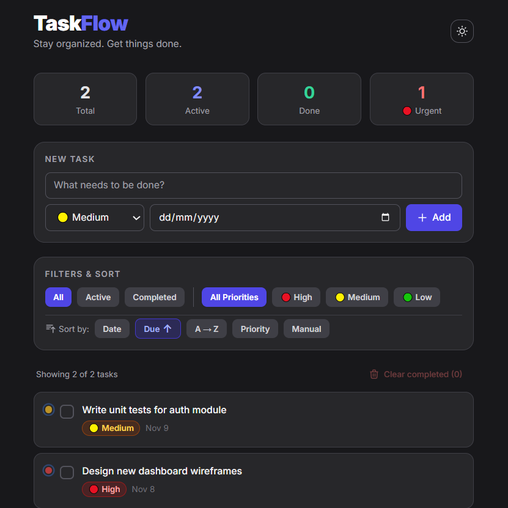

# TaskFlow

A clean and fast task management app built with **React**, **Redux Toolkit** and **Tailwind CSS**. Add tasks with priorities and due dates, filter and sort them, drag to reorder, and switch between dark and light mode. Everything is saved automatically in your browser.



## Features

**Tasks**
- Add tasks with a title, priority (High / Medium / Low) and an optional due date
- Complete or uncomplete tasks with a checkbox
- Edit title, priority and due date inline (Enter to save, Esc to cancel)
- Delete tasks (edit and delete buttons appear on hover)
- **Clear completed** tasks in one click, with a confirmation prompt

**Due dates**
- Due date chip on every task that has one
- Red **Overdue** and amber **Due today** highlighting
- Completed tasks are never shown as overdue

**Filter, sort and reorder**
- Filter by status: All / Active / Completed
- Filter by priority: All / High / Medium / Low
- Sort by Date, Due date, Title (A to Z), Priority or Manual. Click the same sort button again to reverse the order. Tasks without a due date always stay at the bottom when sorting by due date
- **Drag and drop** reordering: drag from the grip handle or from the card itself
- Keyboard accessible dragging (focus the handle, press Space, use arrow keys, press Space again)
- Dragging in an automatic sort mode switches to Manual so your new order is kept
- Works on touch devices (press and hold, then drag)

**Overview and settings**
- Live stats: Total, Active, Done and Urgent (high priority and not completed)
- "Showing X of Y tasks" counter that respects the active filters
- Dark / light mode toggle
- **Auto-save** to `localStorage`: tasks, theme, selected filters and sort mode survive a refresh
- Responsive layout

## Tech Stack

| Technology | Purpose |
|---|---|
| React 18 | UI library |
| Vite | Dev server and build tool |
| Redux Toolkit | Global state management |
| React Redux | Connects React to the store |
| Tailwind CSS 3 | Styling and dark mode |
| dnd-kit | Drag and drop |
| clsx + tailwind-merge | Conditional and conflict-free class names |

## Getting Started

### Prerequisites

- Node.js 18 or higher

### Installation

```bash
# Clone the repository
git clone https://github.com/hyousafdev/taskflow-dashboard.git

# Go to the project folder
cd taskflow-dashboard

# Install dependencies
npm install

# Start the dev server
npm run dev
```

Open the URL shown in the terminal (usually `http://localhost:5173`).

### Other commands

```bash
npm run build     # Create a production build in dist/
npm run preview   # Preview the production build locally
```

## Project Structure

```
src/
├── App.jsx                       # Root component, syncs dark mode to <html>
├── main.jsx                      # Entry point, wraps app in Redux Provider
├── index.css                     # Tailwind directives
├── lib/
│   ├── utils.js                  # cn() class merge helper
│   ├── dates.js                  # Due date helpers (today, format, status)
│   ├── storage.js                # localStorage load / save with validation
│   └── dndSensors.js             # Drag sensors that ignore buttons and inputs
├── constants/
│   └── priority.js               # Priority order, colors and icons
├── store/
│   ├── store.js                  # Store setup, preloaded state, auto-save
│   ├── tasksSlice.js             # Tasks state and reducers
│   ├── filterSlice.js            # Filter and sort state
│   └── uiSlice.js                # Dark mode state
├── hooks/
│   ├── useAppStore.js            # useAppDispatch and useAppSelector
│   ├── useTaskStats.js           # Derived counts for the stats bar
│   └── useFilteredTasks.js       # Filter and sort logic
└── components/
    ├── ui/                       # Button, Input, Select, Badge, Icons
    ├── layout/                   # Header, StatsBar
    └── tasks/
        ├── AddTaskForm.jsx       # New task form
        ├── FilterBar.jsx         # Status, priority and sort controls
        ├── ListToolbar.jsx       # Task counter and clear completed
        ├── TaskList.jsx          # List and drag and drop context
        ├── SortableTaskItem.jsx  # Drag wrapper around a task
        └── TaskItem.jsx          # Single task card (view and edit modes)
```

## How It Works

The app uses three Redux slices:

| Slice | Holds |
|---|---|
| `tasks` | The list of tasks and the next id. Reducers: add, toggle, edit, delete, clear completed, set order |
| `filter` | Selected status, priority and sort settings |
| `ui` | Dark mode flag |

Components read data with `useAppSelector` and update it with `dispatch`. Derived data (stats, the filtered and sorted list) is computed in custom hooks with `useMemo`, so it is never stored twice and always stays in sync.

```
User action -> dispatch(action) -> reducer updates store -> subscribed components re-render
```

**Persistence.** `store.subscribe` saves `tasks`, `ui` and `filter` to `localStorage` whenever they change. On startup, `loadState()` reads and validates the saved data and passes it to the store as `preloadedState`. If the data is missing or invalid, the app falls back to its default sample tasks.

**Manual order.** The order of the `tasks` array is the manual order. Dragging a task dispatches `setTaskOrder` with the new order of the visible tasks, so reordering also works while a filter is active.

## Notes

- Data is saved per browser and per site. It is not synced across devices.
- To reset to the sample tasks, run `localStorage.removeItem("taskflow-state-v1")` in the browser console and refresh.

## Roadmap

## Roadmap

- ✅ Persist tasks in `localStorage`
- ✅ "Clear completed" button
- ✅ Due dates
- ✅ Drag and drop reordering
- ✅ Sort by due date
- ✅ Remember the selected filters and sort mode